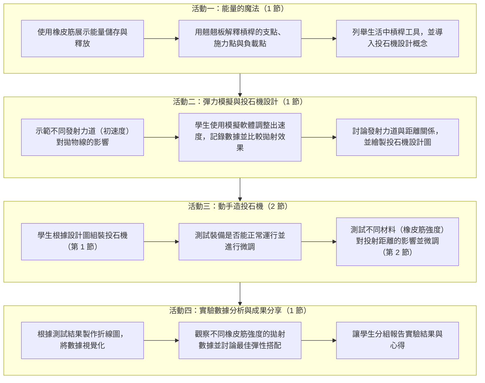

# 國小科技資訊教育教案：投石戰車

> **課程成果**：115 學年度第一學期科技領域教材教法  
> **指導老師**：顏榮泉老師  
> **教學設計團隊**：周昱芊、陳新宜、何羽喬、許睿芯  
> **適用年級**：國小六年級  
> **課程領域**：自然科學領域（1 節）＋ 資訊科技領域（4 節），合計 5 節（200 分鐘）  
> **教學設備**：投石機實作材料、電腦、學習單、Tinkercad 3D 繪圖平台、拋射模擬軟體  

---

## 1. 雙向細目表

| 學習內容 \ 學習表現 | 科議 k-Ⅲ-1<br>說明常見科技產品的用途與運作方式 | 資議 t-Ⅲ-1<br>運用常見的資訊系統<br>科議 s-Ⅲ-1<br>製作圖稿以呈現設計構想 | 科議 c-Ⅲ-1<br>依據設計構想進行實作<br>科議 s-Ⅲ-2<br>使用常見的手工具與材料 | 資議 t-Ⅲ-3<br>運用運算思維解決問題<br>科議 c-Ⅲ-3<br>展現合作問題解決的能力 |
|---|---|---|---|---|
| **科議 N-Ⅲ-1**：科技的基本特性<br>**自 INb-Ⅲ-4**：力可藉由簡單機械傳遞 | 理解槓桿的基本概念，並應用在投石器上。 | | | |
| **科議 P-Ⅲ-1**：基本的造形與設計 | | 利用 Tinkercad 繪製投石器。 | | |
| **科議 P-Ⅲ-2**：工具與材料的使用方法 | | | 能依據設計圖完成投石機的組裝，並測試功能。 | |
| **資議 D-Ⅲ-2**：系統化資料管理方法 | | | | 能根據測試數據進行分析，並使用表格呈現不同彈力與速度的關係。 |

---

## 2. 教案概述

### 課程基本資訊

- **科目 / 領域別**：自然科學領域（1 節）、資訊科技領域（4 節），合計 5 節
- **教學節數**：共 5 節（200 分鐘）
- **實施年級**：國小六年級
- **教學設備**：投石機材料組、電腦教室（含網路）、學習單

### 專題摘要

本課程旨在引導六年級學生透過投石機的製作、材質變因測試，深入理解**彈性位能與動能轉換機制**，以及**槓桿原理**的應用。課程中學生將更換不同彈性的橡皮筋作為發射動力來源，實際觀測並比較彈性強弱對拋射狀況及飛行遠近的影響。

課程設計切合學生的學習特質，以動手實作與數位模擬為核心，著重強化知識應用與驗證能力，進而培養數據分析與問題解決的核心素養。透過結合科技與資訊教育，學生不僅能掌握基礎物理概念，更能運用運算思維剖析實驗變因，最終經由小組合作與成果報告展現學習成效。

### STEAM 教育設計面向

- 🔬 **Science (科學)**：彈性位能的原理、能量轉換為動能的過程、槓桿原理（支點、施力點、抗力點）。
- 💻 **Technology (技術)**：在電腦上繪製投石器設計圖（利用 Tinkercad）與數位拋射模擬軟體。
- 🛠️ **Engineering (工程)**：手作組裝投石車並進行結構測試，針對不同彈性材料進行改裝與驗證。
- 🎨 **Art (藝術)**：設計投石車外觀與結構美編造型。
- 📐 **Mathematics (數學)**：量測橡皮筋伸長量與彈性，並繪製統計折線圖分析彈射速度與飛行距離的關係。

### 先備知識

1. **簡單機械與槓桿原理**：學生具備槓桿的基礎概念（能辨識支點、施力點、抗力點/負載點），並對日常生活中彈性物體（如橡皮筋、彈簧）的形變與彈性特徵有基本認識。
2. **數據記錄與統計圖表判讀**：學生具備測量長度與角度、記錄實驗數值的能力，並能閱讀與繪製基礎統計圖表（如折線圖、長條圖），以利後續分析拉伸角度、彈性與投擲距離之間的關聯。
3. **資訊科技與數位工具操作**：學生具備基本的電腦操作能力（如瀏覽器操作、滑鼠點擊拖曳與鍵盤輸入），能順利進入線上模擬軟體進行拋射參數設定，並使用軟體輔助記錄實驗數據。

### 總綱之核心素養

- **A2 系統思考與解決問題**：具備問題理解、思辨分析、推理批判的系統思考與後設思考素養，並能行動與省思，以有效處理及解決生活、生命常面臨的問題。
- **B3 藝術涵養與美感素養**：具備藝術感知、創作與鑑賞能力，體會藝術文化之美。
- **C2 人際關係與團隊合作**：具備友善的人際情懷及與他人建立良好互動關係之素養，並在團隊中展現合作與溝通能力。

### 學習重點

#### 科技教育
- **學習內容**：
  - `N-Ⅲ-1`：科技的基本特性。
  - `P-Ⅲ-1`：基本的造形與設計。
  - `P-Ⅲ-2`：工具與材料的使用方法。
- **學習表現**：
  - `k-Ⅲ-1`：說明常見科技產品的用途與運作方式。
  - `s-Ⅲ-1`：製作圖稿以呈現設計構想。
  - `c-Ⅲ-1`：依據設計構想進行實作。
  - `c-Ⅲ-3`：展現合作問題解決的能力。
  - `a-Ⅲ-2`：展現動手實作的興趣及正向的科技態度。

#### 資訊教育
- **學習內容**：
  - `D-Ⅲ-2`：系統化資料管理方法。
- **學習表現**：
  - `t-Ⅲ-1`：運用常見的資訊系統。
  - `t-Ⅲ-3`：運用運算思維解決問題。

### 學習目標

1. 學生能說明**彈性位能與動能轉換**的原理，並解釋其在投石機動力釋放中的應用。
2. 學生能指出**槓桿的三要素**（支點、施力點、抗力點），並分析其在投石機結構與拋射時的作用。
3. 學生能操作**電腦模擬軟體**調整投射角度與速度，並系統化記錄拋射軌跡與落點數據。
4. 學生能依據設計圖稿正確且安全地使用手工具，合作組裝簡易投石機結構。
5. 學生能針對不同拉伸角度進行多次拋射測試，並實測比較不同彈性材料（如各款橡皮筋）對投擲性能的影響。
6. 學生能將拋射數據整理繪製為折線圖等統計圖表，分析拉伸角度、彈性與投射距離的關聯，並總結出最佳發射條件。

---

## 3. 評量根據

| 項次 | 學習表現評量標準 | 對應學習內容 | 具體評量方式與根據 |
|:---:|---|---|---|
| **1** | **k-Ⅲ-1**：說明常見科技產品的用途與運作方式 | `N-Ⅲ-1`：科技的基本特性<br>`自 INb-Ⅲ-4`：力可藉由簡單機械傳遞 | **評量工具**：引導式問答、口頭報告。<br>**評量根據**：根據學生的口頭描述，觀察是否能清楚解釋投石機的功能及運作原理，並能聯繫生活應用。 |
| **2** | **s-Ⅲ-1**：製作圖稿以呈現設計構想 | `P-Ⅲ-1`：基本的造形與設計 | **評量工具**：設計圖稿、Tinkercad 設計作品。<br>**評量根據**：檢查學生是否能利用 Tinkercad 繪製投石機設計圖，清楚呈現投石機的基本結構、造形及設計構想。 |
| **3** | **c-Ⅲ-1**：依據設計構想進行實作 | `P-Ⅲ-2`：工具與材料的使用方法 | **評量工具**：教師觀察、實作作品檢查。<br>**評量根據**：觀察學生是否能依照設計圖，安全且正確地使用工具與材料完成投石機組裝，並確認作品能正常運作。 |
| **4** | **c-Ⅲ-3**：展現合作問題解決的能力 | `P-Ⅲ-1`：基本的造形與設計 | **評量工具**：小組互評表、教師觀察紀錄。<br>**評量根據**：觀察學生是否能與組員分工合作，在投石機製作與測試過程中共同討論問題、提出改善方法並完成作品。 |
| **5** | **a-Ⅲ-2**：展現動手實作的興趣及正向的科技態度 | `P-Ⅲ-2`：工具與材料的使用方法 | **評量工具**：教師觀察、學習單、學習心得。<br>**評量根據**：觀察學生是否能積極參與投石機製作與測試活動，主動嘗試不同設計與材料，遇到困難時願意持續改進，並展現正向的學習態度。 |
| **6** | **t-Ⅲ-1**：運用常見的資訊系統 | `D-Ⅲ-2`：系統化資料管理方法 | **評量工具**：電腦紀錄表、電子試算表。<br>**評量根據**：檢查學生是否能運用電腦記錄不同拉伸長度及投射距離等實驗數據，並正確整理成表格與圖表。 |
| **7** | **t-Ⅲ-3**：運用運算思維解決問題 | `D-Ⅲ-2`：系統化資料管理方法 | **評量工具**：數據分析報告、圖表成果、小組口頭報告。<br>**評量根據**：檢視學生是否能根據實驗數據，比較不同拉伸長度對投射距離的影響，分析結果並提出改善投石機效能的方法。 |

---

## 4. 課程設計架構圖



---

## 5. 教學活動步驟

### 活動一：能量的魔法（第 1 節，40 分鐘）

- **活動簡述**：學生能藉由彈性物品的操作，理解彈性位能的儲存與釋放過程；並運用翹翹板認識槓桿的基本原理，進一步思考並探究投石機的設計構想。
- **學習指標**：`科議 k-Ⅲ-1`
- **學習目標**：學生能說明彈性位能的釋放過程，認識槓桿的基本原理，並了解這些原理如何運用在投石機的設計上。
- **學習內容**：`科議 N-Ⅲ-1`、`自 INb-Ⅲ-4`

| 教學活動名稱 | 活動內容（含時間分配） | 評量方式 | 備註與評量規準 |
|---|---|---|---|
| **探索槓桿與彈性位能** | 1. 使用生活中的彈性物品（如橡皮筋、彈簧玩具）展示彈性位能的儲存與釋放。（5 mins）<br>2. 讓學生利用不同橡皮筋測量同一個物體，測量每個橡皮筋被拉多長（拉長後長度－原始長度），觀察橡皮筋的彈性，以及如何釋放儲存的能量，進而投射物體。（8 mins） | 引導式問答、學習單 | 1. 能舉出生活中的彈性物品，並說明拉長或壓縮時儲存能量、放開時釋放能量。<br>2. 能正確測量並記錄橡皮筋原始長度、拉長後長度，並計算伸長量。<br>3. 能比較不同橡皮筋伸長量與投射距離之關係。 |
| **槓桿翹翹板** | 1. 介紹槓桿的基本概念（支點、施力點、負載點），並用「翹翹板」的例子幫助學生理解。（12 mins）<br>2. 運用線上互動遊戲，讓學生觀察支點位置改變時，翹翹板的平衡狀態與施力大小有何不同，進而將槓桿原理與生活經驗相互連結。（10 mins） | 引導式問答、口頭報告 | **評量依據**：根據學生的口頭描述，觀察是否能清楚解釋投石機的功能及運作原理，並能與生活做聯繫，是否能舉例出生活中還有哪些槓桿原理。 |
| **生活中的工具** | 讓學生列舉生活中其他運用槓桿的工具（如剪刀、老虎鉗等），並讓他們想像如何將這些原理應用在投石機上。（5 mins） | 引導式問答、口頭報告 | 1. 能列舉至少兩種生活中運用槓桿原理的工具。<br>2. 能指出所列工具的支點、施力點與抗力點。<br>3. 能將槓桿原理遷移到投石機的設計，說明投石機支點位置與槓桿臂長短如何影響投射效果。 |

---

### 活動二：彈力模擬與投石機設計（第 2 節，40 分鐘）

- **活動簡述**：透過電腦模擬軟體測試不同力道（模擬橡皮筋彈性大小）對拋射距離的影響，並記錄數據進行分析，進而繪製出利用彈性驅動的投石機設計圖稿。
- **學習指標**：`資議 t-Ⅲ-1`、`科議 s-Ⅲ-1`
- **學習目標**：學生能利用電腦模擬不同發射初速度對拋射距離的影響，並依據結果設計出投石機草圖。
- **學習內容**：`科議 P-Ⅲ-1`

| 教學活動名稱 | 活動內容（含時間分配） | 評量方式 | 備註與評量規準 |
|---|---|---|---|
| **彈道視界–數位模擬初探** | 1. 教師示範操作模擬軟體，引導學生觀察在固定發射方向下，不同初始速度（對應橡皮筋彈性強弱）對物體拋射軌跡與落點遠近的影響。<br>2. 結合日常經驗（如拉緊橡皮筋射出、彈珠發射），引發學生探究「彈力大小如何決定拋射距離」的學習動機。（8 mins） | 口頭評量 | **評量依據**：學生能理解並口頭說明彈力大小、初速度與拋射距離之間的因果關係。<br>*備註：附電腦模擬軟體操作介面圖。* |
| **彈力解密–速度變因實測** | 1. 學生分組操作模擬系統，設定固定發射方向，逐步遞增/調整不同的發射初速度（模擬橡皮筋彈性變因），觀察並記錄每次物體的飛行距離。（6 mins）<br>2. 進行多組初速度數值測試，系統化驗證初速度越快、拋射距離越遠的物理現象。（6 mins） | 紀錄表（學習單一） | **評量依據**：檢視《實驗紀錄表-電腦模擬》，確認學生是否如實且完整記錄各組初速度數值與對應的拋射距離。<br>*備註：附《實驗紀錄表-電腦模擬》教學示例圖。* |
| **藍圖誕生–投石機構想與繪圖** | 1. 數據統整與討論：引導學生分析紀錄表數據，得出「橡皮筋彈性越好／初速越快，拋射效果越佳」的結論，作為實體製作時材料選擇與安裝的參考依據。（10 mins）<br>2. 設計圖稿繪製：各組參考網路結構範例與槓桿原理，討論如何將橡皮筋安裝於支架上以提供最佳彈力，並合作在學習單上繪製出投石機的結構設計圖。（10 mins） | 口頭評量、設計圖（學習單二） | **評量依據**：觀察小組討論時是否能結合模擬數據，並檢視《我們的設計圖》是否清晰標示投石臂、支點以及橡皮筋安裝位置。<br>*備註：附《我們的設計圖》學習單示例圖。* |

---

### 活動三：動手造投石機（第 3、4 節，80 分鐘）

- **活動簡述**：學生根據設計圖組裝投石機並進行測試與微調。
- **學習指標**：`科議 a-Ⅱ-2`、`科議 c-Ⅲ-1`、`科議 s-Ⅲ-2`
- **學習目標**：學生能根據設計圖完成投石機的組裝，測試其功能是否能正常運行，並探討不同橡皮筋強度對投影距離的影響。
- **學習內容**：`科議 A-Ⅲ-2`（科技產品的基本設計及製作方法）、`P-Ⅲ-2`

| 教學活動名稱 | 活動內容（含時間分配） | 評量方式 | 備註與評量規準 |
|---|---|---|---|
| **動手造投石機 － 我來做看看** | 學生根據設計圖進行投石機組裝。（30 mins） | 教師觀察 | **評量依據**：確認學生是否能安全、正確地使用工具和材料進行投石機組裝，符合安全操作規範。 |
| **動手造投石機 － 小零件大影響** | 1. 測試裝備是否能正常運行與調整。（10 mins）<br>2. 測試不同材料（不同橡皮筋強度）對投影距離的影響。（10 mins） | 教師觀察 | **評量依據**：確認學生是否能正確測試不同橡皮筋強度並觀察其對投射距離的影響。 |
| **動手造投石機 － 測試與調整** | 學生測試不同橡皮筋強度對投射距離的影響並微調。（30 mins） | 作品檢查、實驗記錄表（學習單三） | **評量依據**：根據學生的最終作品與紀錄，檢查投石機是否可正常運行並完成距離測試與微調。 |

---

### 活動四：實驗數據分析與成果分享（第 5 節，40 分鐘）

- **活動簡述**：學生整理投石機實驗數據，製作折線圖，分析不同拉伸角度對投射距離的影響，並透過分組報告分享實驗成果與心得。
- **學習指標**：`科議 a-Ⅲ-2`、`資議 t-Ⅲ-3`、`資議 D-Ⅲ-2`
- **學習目標**：
  1. 能整理實驗數據並繪製折線圖。
  2. 能透過圖表分析拉伸角度與投射距離的關係。
  3. 能與組員合作討論最佳投射角度，並分享實驗結果與心得。
- **學習內容**：投石機實驗數據整理、折線圖製作、投射角度與距離的關係分析、實驗成果分享與反思。

| 教學活動名稱 | 活動內容（含時間分配） | 評量方式 | 備註與評量規準 |
|---|---|---|---|
| **一、實驗數據整理** | 1. 教師引導學生回顧上一節投石機測試結果。<br>2. 各組整理不同拉伸長度所測得的投射距離。<br>3. 將實驗數據記錄於學習單中。（8 mins） | 實作評量 | 能正確整理並記錄實驗數據於《投石機實驗紀錄表》。 |
| **二、繪製折線圖** | 1. 教師示範如何將實驗數據轉換成折線圖。<br>2. 學生以拉伸長度為橫軸、投射距離為縱軸繪製折線圖。<br>3. 觀察圖表中數據的變化趨勢。（12 mins） | 實作評量 | 能正確繪製折線圖並標示座標軸（方格紙、尺、學習單）。 |
| **三、分析與討論** | 1. 各組觀察不同拉伸長度的投射數據。<br>2. 討論哪個長度能達到最遠的投射距離。<br>3. 引導學生思考影響投射距離的其他因素。（10 mins） | 口語評量 | 能根據實驗數據提出合理解釋，並參與小組討論。教師引導學生以實驗數據作為判斷依據。 |
| **四、成果分享與反思** | 1. 各組分享實驗結果與最佳投射長度及原因。<br>2. 說明實驗過程中遇到的問題與解決方式。<br>3. 教師統整實驗結果，引導學生反思投石機的改良方向。（10 mins） | 口語評量、互評表（學習單四） | 能清楚表達實驗結果與心得；完成小組成果發表與同儕互評。 |

---

## 6. 教學回饋與注意事項

### 可能遇到的狀況與因應策略

1. **學生操作困難**：部分學生平時較少接觸類似手工具，操作時可能不熟練。教師可提供較多的示範與逐步指導，並在學生操作時巡視協助，必要時請操作熟練的同學從旁協助。
2. **數據紀錄及分析不完善**：學生在記錄數據與繪製圖表時，可能出現記錄不完整、數值有誤或不知如何作圖的情形，需要多關心並輔導學生紀錄，以確保數據正確；教師可事先準備圖表模板，讓無法自行完成圖表的學生直接填入數據套用，以便順利銜接下一個學習步驟。
3. **概念未完全理解**：部分學生可能難以分辨支點、施力點與抗力點，或無法將槓桿原理與投石機的結構連結；教師可先以翹翹板、剪刀等生活實例搭配圖示逐一標示，並提供已標好三點位置的投石機簡圖，讓學生對照後再自行練習標示。
4. **設計與繪圖困難**：學生在使用繪圖軟體（如 Tinkercad）時，可能不熟悉軟體操作以及不懂如何設定尺寸、孔位位置與卡榫間隙等問題；教師可先提供基本零件模板檔（如側板、投擲臂），讓學生只修改臂長或孔位數值，無法完成設計的學生可直接套用模板進入雷切或組裝製作。
5. **時間管理與小組合作問題**：部分小組可能因分工不均或進度落後，無法完成組裝與測試；教師可事先分配組員角色（記錄員、操作員、測量員、報告員），並預留預先組裝好的投石機供進度落後的小組使用，確保能進行後續的測試與討論。

### 注意事項

> [!CAUTION] 教具與材料安全規範
> - 確保學生正確使用木條、橡皮筋等材料避免彈傷或刺傷。
> - 操作剪刀或手工具前，務必提醒學生遵守安全規範，並佩戴必要的護目鏡等防護裝備。

> [!IMPORTANT] 活動場所動線規劃
> - 進行投射測試時，務必在教室或走廊設立專用**射擊安全區域**，嚴禁對著人射擊。
> - 確認發射路徑與落點周圍無易碎品或高危險物品。

> [!TIP] 資料紀錄與討論引導
> - 提醒學生仔細記錄每次測試的真實數據，不隨意修改數值。
> - 鼓勵組內深入討論，用數據說話，釐清最佳投射條件的因果關係。

---

## 7. 附錄：學習單與評估表

### 附錄一：實驗紀錄表 - 電腦模擬

```text
六年___班   第___組   組長：__________   組員：____________________

🎯 模擬任務說明：
1. 在模擬軟體中維持「固定發射方向（45°）」，分別測試不同出速度（模擬橡皮筋不同彈力強度）。
2. 每次設定進行 3 次模擬發射，並計算平均拋射距離（公尺）。

+----------+--------------------+-------------+-------------+-------------+------------+
| 模擬次序 | 模擬出速度 (m/s)    | 第 1 次距離  | 第 2 次距離  | 第 3 次距離  | 平均距離   |
+----------+--------------------+-------------+-------------+-------------+------------+
| 測試 A   | 弱（例如 10 m/s）  | ______ m    | ______ m    | ______ m    | ______ m   |
| 測試 B   | 中（例如 15 m/s）  | ______ m    | ______ m    | ______ m    | ______ m   |
| 測試 C   | 強（例如 20 m/s）  | ______ m    | ______ m    | ______ m    | ______ m   |
| 測試 D   | 特強（自訂速度）   | ______ m    | ______ m    | ______ m    | ______ m   |
+----------+--------------------+-------------+-------------+-------------+------------+

💡 數據發現與思考：
1. 觀察上方表格，當發射出速度越快時，物體的飛行距離有什麼變化？
   答：出速度越快，拋射的距離越【 □ 遠  □ 近 】，這代表物體獲得的動能越【 □ 大  □ 小 】。

2. 如果要把模擬實驗中的「出速度」應用到真實投石機上，我們可以如何增加發射力道？
   答：__________________________________________________________________________。

3. 小組結論：我們預計在下一節實作中，使用什麼樣的橡皮筋搭配？
   語言下模塑（範例：使用粗橡皮筋、增加橡皮筋條數...）：______________________。
```

---

### 附錄二：我們的設計圖！！！

```text
六年___班   第___組   作品名稱：____________________   繪圖者：____________

📐 投石機結構草圖（請標示：① 支點  ② 橡皮筋固定處  ③ 投射臂  ④ 盛彈處）

+-----------------------------------------------------------------------+
|                                                                       |
|                                                                       |
|                  【 請在此繪製投石機側視或立體圖 】                   |
|                                                                       |
|                                                                       |
+-----------------------------------------------------------------------+

🛠️ 機構特點與變因規劃：
1. 彈力來源規劃（橡皮筋安裝方式）：
   預計使用【 □ 細橡皮筋  □ 粗橡皮筋  □ 多條併用 】，固定在裝置的什麼位置？
   答：_________________________________________________________________。

2. 槓桿結構設計（支點與力臂）：
   支點設置在投射臂的【 □ 中間  □ 偏前  □ 偏後 】，這樣設計的優點是？
   答：_________________________________________________________________。

3. 小組創意與結構加固巧思：
   答：_________________________________________________________________。
```

---

### 附錄三：實驗紀錄表 - 投石機實測

```text
六年___班   第___組   紀錄人員：__________   發射手：__________

🔬 實驗變因控制原則：
- 【控制變因】：維持相同的拉伸位置、投擲物重量，投石機底座保持穩固不滑動。
- 【操縱變因】：更換「不同彈性強度」的橡皮筋（如單條細、單條粗、雙條細、雙條粗）。

+----------+---------------------+------------+------------+------------+------------+
| 組別次序 | 橡皮筋材質 / 規格    | 第 1 次 (cm)| 第 2 次 (cm)| 第 3 次 (cm)| 平均距離   |
+----------+---------------------+------------+------------+------------+------------+
| 條件 1   | 單條細橡皮筋（弱）  | _____ cm   | _____ cm   | _____ cm   | _____ cm   |
| 條件 2   | 雙條細橡皮筋（中）  | _____ cm   | _____ cm   | _____ cm   | _____ cm   |
| 條件 3   | 單條粗橡皮筋（強）  | _____ cm   | _____ cm   | _____ cm   | _____ cm   |
| 條件 4   | 雙條粗橡皮筋（特強）| _____ cm   | _____ cm   | _____ cm   | _____ cm   |
+----------+---------------------+------------+------------+------------+------------+

🔍 實測觀察與結構調整：
1. 實測結果符合電腦模擬的預期嗎？哪一種橡皮筋組合讓投石機射得最遠？
   答：射得最遠的材料組合是【                      】，平均距離為【      】公分。

2. 在更換更強彈性的橡皮筋時，投石機結構是否出現晃動或不穩的狀況？你們如何加固？
   答：_________________________________________________________________________。

3. 根據這次的實測數據，下一節課我們要在圖表上呈現的關鍵結論是：
   答：_________________________________________________________________________。
```

---

### 附錄四：實驗結果評估表（自評與互評）

```text
評分组別：第___組      受評組別：第___組      評審學生：__________

評分標準：⭐⭐⭐⭐⭐ 表現優異（5分）| ⭐⭐⭐ 良好（3分）| ⭐ 需加強（1分）

+----------+-------------------------------------------------------+-------------+
| 面向     | 評量指標與表現                                         | 自評/互評得分|
+----------+-------------------------------------------------------+-------------+
| 科學概念 | 彈性位能與槓桿原理理解                                 | 【   / 5 】分|
|          | 能清楚說明橡皮筋彈性強弱對拋射動能與飛行遠近的影響。  |             |
+----------+-------------------------------------------------------+-------------+
| 工程實作 | 投石機結構組裝與穩固性                                 | 【   / 5 】分|
|          | 能根據設計圖完成組裝，且發射時支架穩固，發射臂運動順暢。|             |
+----------+-------------------------------------------------------+-------------+
| 數據分析 | 圖表記錄與結果詮釋                                     | 【   / 5 】分|
|          | 能將不同彈性數據正確繪製成折線圖，並精準解讀數據趨勢。|             |
+----------+-------------------------------------------------------+-------------+
| 團隊合作 | 分工溝通與解決問題                                     | 【   / 5 】分|
|          | 小組分工明確，在實作遇故障或誤差時能共同討論修復。    |             |
+----------+-------------------------------------------------------+-------------+
|          | 總得分合計（滿分 20 分）：                             | 【   / 20】分|
+----------+-------------------------------------------------------+-------------+

💬 最欣賞這組的地方 / 建議改進方向：
_________________________________________________________________________________
_________________________________________________________________________________

⚠️ 回去檢查看看，是否每一項都有評分？如果都完成了，就可以繳交囉！🎉
```
